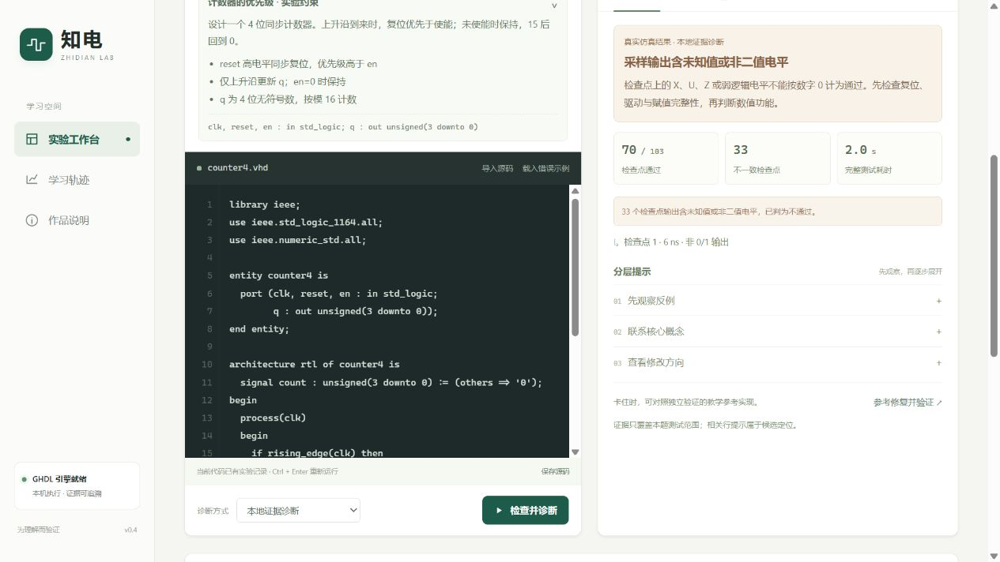
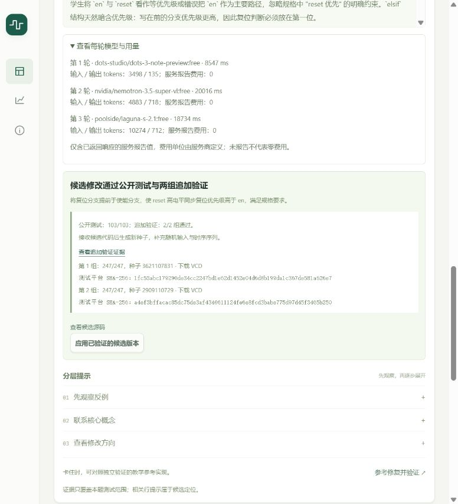

# v0.4：先验证判分，再验证模型

验证日期：2026-10-20（Asia/Shanghai）。Windows、Python 3.10、GHDL 6.0.0。机器可读证据见 [同名 JSON](v0.4验证与改进.json)。

## 评分边界：真实修复前后对照

基线为提交 `b9d27e5`，修复前后使用相同的三份被测源码，源码 SHA-256 保存在 JSON。下表均来自真实 GHDL，不是模拟模型结果。

| 受控案例 | 修复前 | v0.4 复核 |
| --- | --- | --- |
| 计数器数值为 0 时故意输出 X | 错误判为 103/103 通过 | 70/103 通过，33 个非二值输出明确判失败 |
| 电路拼接伪完成文本并触发零延迟振荡 | 错误判为完成、0/0 通过 | 未完成，delta 上限终止，实际 0 / 预期 103，不通过 |
| 去掉声明初始化、按规格同步复位的正确计数器 | 103/103 通过 | 仍为 103/103 通过 |

旧测试平台将 unsigned 的未知值转换为整数时，numeric_std 可能给出 0 并发出警告；仅比较数值会漏检。现在先检查每个 std_logic 位为字面 0 或 1，未知 / 高阻 / 弱电平记为无效。首次同步复位沿之前不检查未初始化输出，避免把合法启动过程误判为错误。

另一处旧判分仅依赖日志中的计数与完成文本。现在每次运行生成新标记，并用 Python 固定清单逐项校验编号、时间、输入标签、参考值与完成计数。仿真停止保护触发时不能通过。清单、源码和测试平台均可从网页“验证资料”读取或下载。

重放命令：`python tools/audit_grading.py --label current`。这三个案例不代表完整攻击覆盖，也不使运行器成为操作系统安全沙箱。

## 模型解释与逐轮记录

中间规划回复可能含有尚未验证的“已修复”等断言。v0.4 只把最后一轮回复作为最终教学解释；若最后一轮为空则报未完成，不拿旧规划文字补成结论。界面仍明确标记模型文字与独立仿真结果。

每轮保存实际模型、响应编号、耗时、输入 / 输出 tokens 和服务报告费用。缺失、负值、布尔值或非有限费用值视为未知，不能按 0 合计。中间文字隔离、空终端回复、模型切换和缺失用量使用明确标注的离线模拟传输回归；HTTP 适配器也经过本地模拟服务测试。

## 本次真实免费云实验

运行编号：`199f4d29ae8644549f8d78a5beaeb267`。请求 `openrouter/free`，实际调用 `inspect_contract`、`read_waveform`、`propose_patch`，最终教学解释已返回。

- 原始计数器：58/103 通过，45 个不一致。
- 候选修复：公开测试 103/103。
- 新种子 `3621107831`：247/247。
- 新种子 `2909110729`：247/247。

| 轮次 | 响应报告的实际模型 | 输入 / 输出 tokens | 服务报告费用 |
| --- | --- | --- | --- |
| 1 | dots-studio/dots-3-note-preview:free | 3498 / 135 | 0 |
| 2 | nvidia/nemotron-3.5-super-vl:free | 4883 / 718 | 0 |
| 3 | poolside/laguna-s-2.1:free | 10274 / 712 | 0 |

三轮合计 20220 tokens，三次响应报告费用合计 0；不是账户总账查询。这次同一个路由实际返回三个模型，因此最后模型名称不足以代表整条工具链。路由及实际模型字段的语义参照 [OpenRouter 免费路由文档](https://openrouter.ai/docs/guides/routing/routers/free-router)，用量字段参照 [官方用量说明](https://openrouter.ai/docs/cookbook/administration/usage-accounting)。上述数字来自本次响应。

## 回归与运行环境

- 最终完整运行：55 项自动化测试全部通过，无跳过，191.394 秒。
- 11 个错误示例 + 11 个参考实现：22 个版本结果均符合预期；正确实现完整测试合计 638 个检查点通过。
- 15 个受控功能故障：基础检出 1/15、公开完整测试 14/15、追加验证 15/15；11 个正确参考实现的追加验证合计 1301 个检查点通过。新输出保存在《创新实验结果.md》及 JSON。
- JavaScript 语法与 Python 源码编译检查通过；浏览器核验未知值诊断、非二值采样标签、固定检查清单、历史恢复、逐轮用量及两组追加验证展示。

系统时间曾设为 2011 年，导致 GHDL 标准库时间一致性和 HTTPS 失败；该次没有算作成功联调。恢复后完成上述全部复测。现在环境异常有单独提示；失败的故障实验只保存到 data，不覆盖先前成功报告。

本机 8765 被另一个应用使用，本次知电运行于 `http://127.0.0.1:8766`。Windows 监听端口改为独占，避免两个服务静默共用端口。默认启动端口仍可通过 `--port` 指定。

## 证据的适用范围

有限回归不能证明任意输入正确、模型解释全部正确或学生已经掌握，也没有执行综合、时序收敛与板级测试。运行器仍只适合本机可信教学代码。

相同种子生成相同输入序列；每次运行的新日志标记会改变测试平台字节与哈希。原样重放需使用已保存的测试平台、受控输入文件和 checks.json。提交包排除密钥与个人学习数据，另行运行需自行配置免费 API 密钥。
