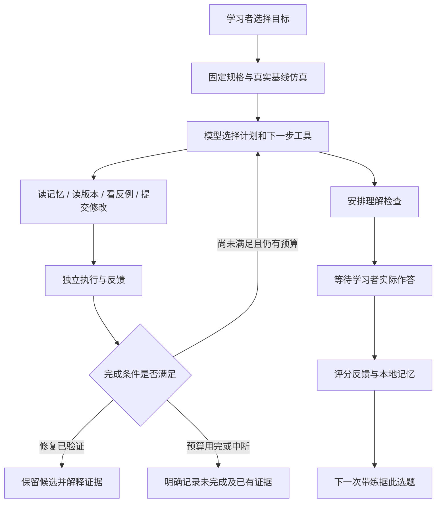
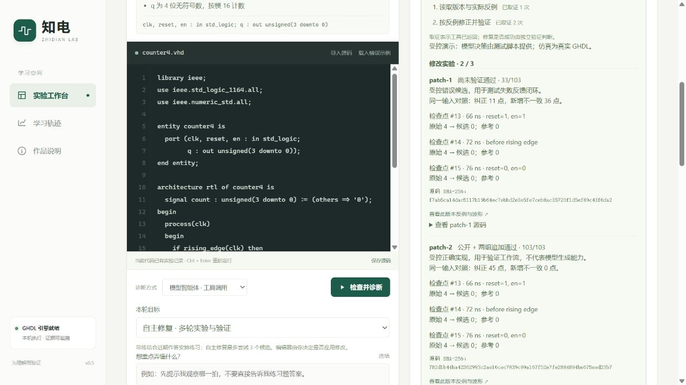
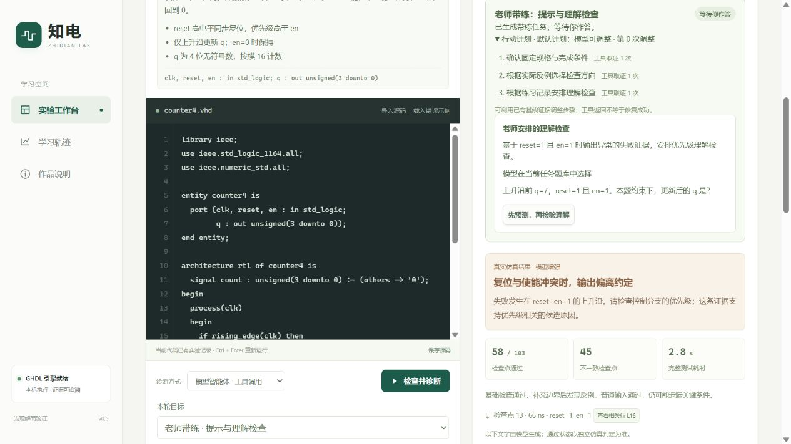
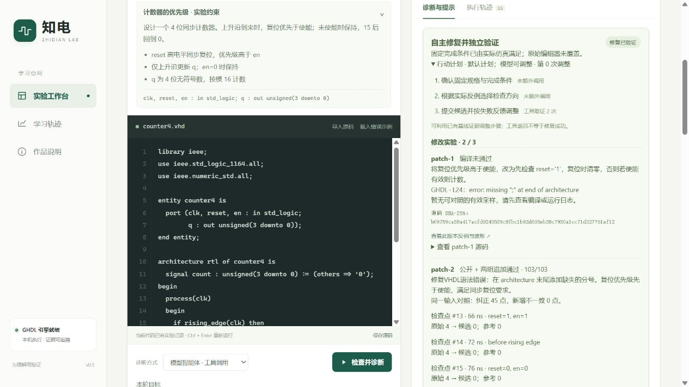
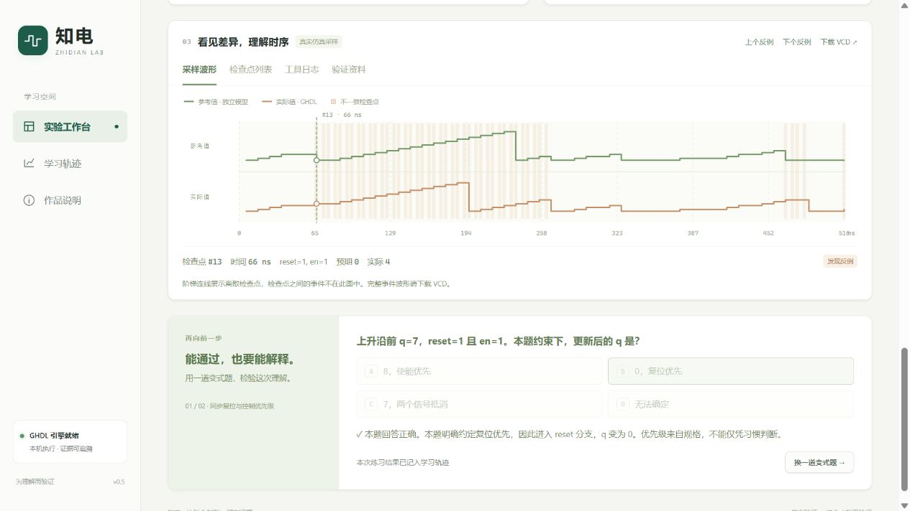

# 知电 v0.5：从实验助教到有目标的教师智能体

日期：2026-10-24（Asia/Shanghai）。本版围绕两件事组织自主行动：帮助学习者理解，以及在固定规格下修复电路。机器可读结果见 [同名 JSON](v0.5教师智能体与验证.json)。

## 已实现的八项改进

| 能力 | 实际行为 | 判定依据 |
| --- | --- | --- |
| 两种主要目标 | 老师带练、自主修复；另保留解释证据模式 | 目标存入每次任务，不由最后一句文字决定完成 |
| 行动计划与调整 | 默认起始计划，模型可用 update_plan 调整 2–6 步，保留旧计划 | 取证次数来自实际工具返回，不把计划当作执行成功 |
| 失败后继续修改 | 候选失败时把编译错误、反例、追加结果反馈给模型 | 最多 3 个不同候选，原始编辑器保持独立 |
| 多版本实验台 | 保留 baseline、patch-1、patch-2 等版本；可读取失败版本源码、波形和日志 | 各版本带源码哈希、独立目录及真实 GHDL 产物 |
| 同输入前后对照 | 展示修改纠正了哪些检查点，又引入哪些不一致 | 编号、时间、输入、类型和参考值均匹配后才比较 |
| 基于记忆的理解检查 | 检索当前任务最近 6 次作答和 3 次实验；优先近期错题，其次未做变式 | 固定的 22 道理解题，不向推荐接口返回答案键 |
| 真实作答反馈闭环 | 学习者选择答案后才评分；反馈绑定本次任务，保存后可恢复 | 推荐题号、任务和实际提交必须匹配，不由模型代答 |
| 过程保存与有界停止 | 阶段和工具返回后原子保存快照；中断后仍能读取已有证据 | 重启识别中断；无验证不能标为修复成功；重复源码不重复仿真 |

这里的“教师”是带练行为定位。系统没有证明学习提升，也不能仅凭代码或一次选择题判断学生已经掌握。

## 九个受控实验

执行 `python tools/evaluate_teacher_agent.py`。**模型决策由脚本提供，编译与仿真为真实 GHDL**；脚本中直接提供正确实现，用于验证工作流，不测量模型生成能力。每个实验有独立数据目录、运行快照和源码哈希，演示界面及报告显式标记其来源。

| 场景 | 实际验证结果 |
| --- | --- |
| 计数器第一版功能错误，读取后再修复 | 第一版 33/103；第二版 103/103、追加 247/247 与 247/247 |
| FIR 迎合公开范围，追加验证失败后再修复 | 第一版公开 50/50 但两组追加失败；第二版公开 50/50、追加各 129/129 |
| 未验证却提前输出“已修好” | 程序要求继续取证，只有候选完成独立验证后才标目标达成 |
| 重复提交同一失败源码 | 返回明确错误，不增加候选版本；实际修改后可继续验证 |
| 三个候选均失败，尝试第四个 | 第四个被预算拒绝，目标为未修好，不伪装成功 |
| 正确版本后又提出错误版本 | 两个版本均保留，已验证的候选仍可应用 |
| 近期错题复习 | 自动选中近期答错题；实际再次答错后记录建议复习，重载后仍保留 |
| 回答正确的检查 | 实际作答后记录反馈，不把“题目已推荐”视作正确 |
| 运行过程中读取持久快照 | 新服务实例可读到第一版失败证据并标记中断；这是受控重启检查，非真实断电测试 |

快照不是自动续跑机制；中断后可查看过程并重新运行。当前记忆检索是按任务和近期记录组织，没有使用向量库或任意聊天长记忆。

## 真实免费云模型实验

使用用户本机配置的 `openrouter/free`，不使用受控脚本替代云模型。以下结论仅限本次实际运行。

### 老师带练

运行 `f8364315dbf1477a9d770c4b0a202380`：4 轮请求、4 次工具调用。模型实际读取当前任务的学习记忆、固定规格和失败波形，安排 `counter_priority` 理解题，最终状态为“等待你作答”。没有代用户提交答案。

四个响应合计报告 26195 tokens、费用 0。最终响应模型为 `nvidia/nemotron-3-ultra-550b-a55b:free`，逐轮模型和请求编号保存在 JSON。

首次联调 `515b9b312fdc4dd3be2395c32cee6a26` 推荐了无效题号，后续模型处理异常，未算成功。随后补充可用题库目录与参数错误中的合法题号提示，复测成功。失败调用的缺失用量仍视作未知，不能计作 0。

### 自主修复

运行 `5287b5b211874dd9a6c7c91ccbcbc0bf`：5 轮请求、4 次工具调用。

1. 原始计数器 58/103 通过。
2. 模型第一个候选在第 24 行缺少分号，GHDL 编译失败。该版本保留为 patch-1，不能记为通过。
3. 下一轮模型根据编译反馈补充分号，提交 patch-2。
4. patch-2 公开 103/103，两组新种子追加各 247/247，目标标记为“修复已验证”。原始编辑器未覆盖。
5. 模型还读取了学习记忆并安排理解检查，最终解释已返回。

五个响应合计报告 49352 tokens、费用 0。最终响应模型为 `nvidia/nemotron-3-ultra-550b-a55b:free`。这里的真实失败反馈是**语法错误**；上表另用受控实验验证功能反例与追加失败后的修订，二者不混为同一模型能力成绩。

费用只表示对应成功返回响应的服务报告值，不是账户总账；免费路由供应和响应速度仍可能变化。

## 测试与浏览器验证

最终完整回归 **71 项全部通过，无跳过，269.682 秒**；JavaScript 语法与 Python 源码编译检查通过。测试覆盖计划与真实完成条件分离、无证据提前结束、候选上限、错题选择、已答对后的未做变式选择、跨任务隔离、无效题号反馈、未安排题目不能绑定作答，以及真实候选修复和记录恢复。

另复现 Windows HTTP 拒绝响应偶发被连接中断覆盖的问题：12 个约 80 KB 的无效令牌请求中，旧行为有 3 个客户端连接中断。拒绝时先丢弃有限长度请求体，保持来源和令牌校验不变，修复后相同 12 次均收到 403，未产生答题记录。最初 70 项全量运行中出现的该连接错误未被忽略；增加回归后重新跑完上述 71 项。

浏览器验证使用真实云历史与独立的受控演示库。验证版本选择后，波形、检查点、VCD 和验证资料对应同一版本；模拟作答保存在演示库，不写入用户真实学习统计。

## 如何用于参赛演示

- 先展示老师带练：读近期记录、围绕实际反例提问、安排理解检查，等待学生回答。
- 再展示真实两轮修复：缺分号 → GHDL 错误 → 新候选 → 公开与追加验证；解释为什么不是“一句回复即完成”。
- 用标记清楚的受控演示补充功能错误与过拟合反例，展示失败版本、输入对照和独立验证。
- 展示预算耗尽案例，说明系统会保留证据并报告未完成。

差异点是“目标驱动的受限工具闭环 + 可复查的教学证据 + 学习者实际参与”。这不是全球首创性结论，也没有使用 VerilogEval 的成绩替代本项目验证。

## 后续创新路线（尚未实现）

| 方向 | 需要补充的条件 | 验证方式 |
| --- | --- | --- |
| 课件依据检索与逐页引用 | 获取原始 PPT，当前仅有标题推测 | 用教师标注的知识点与页码检查检索和引用准确性 |
| 生成新的变式任务 | 建立独立规格模型和题目审核机制 | 参考实现通过、受控错误可检出，不能让同一模型自出自判 |
| 自由回答与逐步追问 | 教师给出评分量规、反例和求助策略 | 人工评分对照与一致性检查，当前只支持固定选择题评分 |
| 学习效果评估 | 真实参与者与独立迁移题 | 区分代码通过、当场回答、延后迁移；目前未开展学习实验 |
| 器件综合与时序反馈 | 合适工具、器件规格或板卡 | 分别验证资源、时序和板级行为，不能拿仿真通过替代 |

当前原型仍限本机可信单文件 VHDL 教学任务。模型解释可能存在概括过度或其他错误；数值、版本和通过状态应回到原始工具证据复查。
